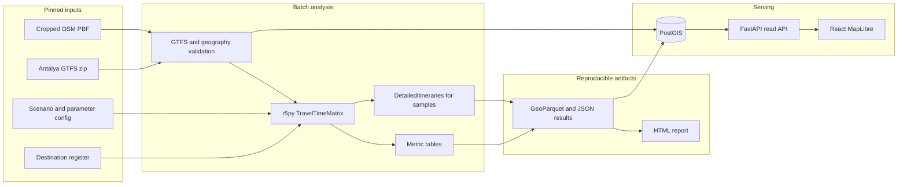

# UrbanPulse Antalya — technical and research design

Status: **awaiting approval**. This document does not authorize implementation.

Inspection date: **29 September 2026**. No accessibility results have been computed. Counts below describe one GTFS snapshot. They are not findings about who in Antalya is underserved.

---

## Research question, restated

The brief asks how *equally* residents can reach essential services, and also uses the word *equitable*. Those are different claims.

This project can measure **spatial variation in scheduled public-transport accessibility**. It cannot measure equity of mobility. Equity would require need, income, age, disability, or demand. Those datasets are not in hand, and several are not available at a defensible geography.

Operational question:

> Inside a pre-registered central Antalya study area, how does scheduled municipal public transport provide access to a pre-registered set of essential destinations, how does that access vary among analysis origins and service periods, and which origins combine long walks, low scheduled frequency, or long modelled journey times?

Every travel time in the project is a **scheduled / modelled** time. It is not observed punctuality, crowding, or the journey a person actually experiences.

---

## What was inspected

There is no official Antalya GTFS download on the municipality site that this review could confirm. The practical feed is a community conversion of the public KentKart API:

- Repository: [Egezenn/kk-gtfs](https://github.com/Egezenn/kk-gtfs)
- File: `data/antalya.zip`
- Git blob SHA inspected: `0476804de3608a121b04bd3a0d956a752bd8ec34`
- Size: 8,960,583 bytes
- Generator source read in full: `kk-gtfs.py` (same repository, `main`)

The generator does not copy an operator GTFS file. It calls KentKart `nearest/find` and `pathInfo`, then writes GTFS. That distinction drives several recommendations below.

Snapshot contents:

| Item | Value |
| --- | --- |
| Files present | `agency.txt`, `routes.txt`, `trips.txt`, `stops.txt`, `stop_times.txt`, `calendar.txt`, `shapes.txt` |
| Files absent | `calendar_dates.txt`, `transfers.txt`, `frequencies.txt`, `pathways.txt`, wheelchair fields |
| Agencies | `1` ANTOBÜS 12MT (159 routes); `99` TEST (10 routes) |
| Routes | 169 |
| `route_type` | 164 bus (`3`), 2 rail (`2`), 3 tram (`0`) |
| Stops | 4,630, no duplicate `stop_id` |
| Trips | 22,034, all trip IDs unique |
| Stop times | 1,297,130 |
| Shapes | 336 shapes, 93,912 points |
| Calendar rows | 3 |
| Stamped service window | 2026-09-01 through 2026-10-31 |

Calendar patterns in this snapshot:

| service_id | Days | Trips |
| --- | --- | --- |
| `service_1_MTWTFss` | Monday–Friday | 7,992 |
| `service_2_mtwtfSs` | Saturday | 7,497 |
| `service_3_mtwtfsS` | Sunday | 6,545 |

Stop coordinate extent: longitude 29.32007 to 32.31751, latitude 36.20068 to 37.23487. Named stops at the edges include Kaş Kınık, Kaş Kalkan, Gazipaşa Merkez, and northern stops such as Ahırtaş and Karaveliler. Two long scheduled runs illustrate the mix of services: route `AK03` Antalya Terminal–Kınık (about 258 minutes, 76 stops, Sunday service) and `GAN01` Gazipaşa Merkez–Antalya Terminal (about 180 minutes, 5 stops).

Stop-time diagnostics on this snapshot:

- No trip has the same timestamp at every stop, so arrival offsets are populated rather than left at zero.
- Median scheduled duration from first to last stop on a trip is 71 minutes (90th percentile 104 minutes; 99th percentile 151.5 minutes).
- 105 trips exceed 3 hours.
- 1,531 stop events have departure before arrival. Of those, 1,347 differ by at most 60 seconds.
- No stop-time row points at a missing stop.
- 7 stops fall outside a loose Antalya Province box used only as a coordinate sanity check. The overall bbox still spans Kaş to Gazipaşa.

A separate `alanya.zip` exists in the same repository and is only 54,123 bytes. Alanya is not “the rest of the Antalya feed.” It is another KentKart region and is out of scope.

These figures will change on the next monthly rebuild. Phase 1 must pin a SHA-256 of the zip, not “whatever is on `main`.”

---

## Challenges to the brief

The brief is right about the scientific topic, the ban on invented data, the separation of data-quality problems from accessibility problems, and the decision to ship a core before optimization or machine learning. Several proposed mechanisms should change.

### 1. Do not build a RAPTOR router

A custom RAPTOR or Connection Scan implementation would mostly test whether a new router was coded correctly. It would not make the Antalya measurement more credible.

Use **[r5py](https://r5py.readthedocs.io/)** (Conveyal R5) for schedule-aware walk-plus-transit accessibility. R5 already samples one departure per minute across a time window and reports a travel-time percentile. That is the right estimator when missing a bus by one minute changes the journey by a full headway (Conway, Byrd, and van der Linden 2017; Conway, Byrd, and van Eggermond 2018). Cite r5py as Fink, Klumpenhouwer, Saraiva, Pereira, and Tenkanen (2022).

r5py’s own default window is **10 minutes**. That default is a poor match for routes whose headway may be 20–40 minutes, because the median of a short window can miss the only useful trip. Research scenarios should set the window to the **whole analysis period** (for example 07:00–09:00), not the library default.

r5py’s default walk speed is **3.6 km/h**. That is a slow walking assumption and must not be inherited silently. The primary run should set **4.8 km/h** and repeat one scenario at 3.6 km/h as a sensitivity check.

`DetailedItineraries` can return segments, wait time, route IDs, and a geometry for a specific origin–destination query. `TravelTimeMatrix` is the city-scale metric. `Isochrones` exists, but it is a visualization of one origin, not the citywide statistic.

OpenTripPlanner is unnecessary for the core. Running two routers on the same GTFS checks software agreement. It does not check whether the feed matches the street.

### 2. A single departure time is the wrong research metric

The brief’s query form (origin, one clock time, destination) is a useful map interaction. It is a weak measure of “how much access this area has,” because the result depends on whether a trip is due now.

City-scale indicators should be the **median scheduled travel time across the scenario window**, plus the share of origins with no journey found inside the maximum modelled time. A one-departure itinerary in the explorer must be labelled separately: “one scheduled departure,” not “the accessibility of this place.”

### 3. “Weekend” hides a split the feed actually has

This snapshot has different Saturday and Sunday calendars, with fewer Sunday trips than weekday trips (6,545 versus 7,992). Collapsing them into one weekend scenario would mix two service patterns.

Report **weekday, Saturday, and Sunday** separately. Pool Saturday with Sunday only after the results show they are similar. There is still no `calendar_dates.txt`, so public holidays are not encoded. **29 October 2026** (Republic Day) falls inside the stamped window and must not be used as an ordinary Thursday.

The calendar start and end dates are written by the generator as “today” and “today + 60 days.” They are not an operator validity statement. Weekday letters come from a seven-character description such as `MTWTFss`, using uppercase versus lowercase. That happened to work in this snapshot. It is a fragile parser, and a future feed could encode days differently. Phase 1 has to re-read `calendar.txt` rather than assume these three patterns are permanent.

### 4. The feed covers more than urban Antalya, and less than the transport people use

The bbox runs from Kaş to Gazipaşa and north into rural mahalles. Treating that extent as one accessibility surface would make Kaş and Gazipaşa dominate any “worst access” list for reasons of distance, not because the urban network was measured carefully.

**Primary study area:** the contiguous central urban service area, delineated in Phase 1 from stop density and district boundaries *before* any accessibility map is interpreted. A working hypothesis, to be confirmed rather than hardcoded, is the central cluster around Muratpaşa, Kepez, Konyaaltı, Döşemealtı, and Aksu.

**Kept in the database, excluded from the comparison set:** provincial scheduled routes such as `AK03` and `GAN01`, and stops at Kaş, Kalkan, and Gazipaşa. The coverage map should show them so the exclusion is visible.

**Missing from the feed, and therefore from every result:** dolmuş / minibüs, hotel and site shuttles, and any operator that does not appear in this KentKart region. The snapshot has two agency IDs only. Residents in some corridors may rely on services this model never sees. “Access without a private car” must be worded as access by the **scheduled services in this feed**.

`alanya.zip` is not merged in.

### 5. Agency `TEST` is not safe to drop or safe to keep blindly

Agency `99` is named `TEST` and holds 10 routes. Some names look operational (`ŞEHİR HASTANESİ-FATİH`, nostalji tramvay, `T1C`, `T1D`). Some look malformed (`T35`, `T5`, with long names that are stop-code strings). Deleting the whole agency would delete Antray variants. Keeping it untouched would let junk routes affect routing.

Phase 1 produces an **include/exclude register**, one row per route, with a reason, before R5 is run. Mode tags also need an explicit correction table: `T1A` and `T1B` are `route_type` 2, `T1C`/`T1D`/`T3` are `route_type` 0, and nostalji tramvay `NT07` is tagged as a bus. Corrections are logged. They are not silent edits.

### 6. H3 is a sampling lattice, not a neighborhood

H3 resolution should not be chosen because hexes look analytical. Administrative mahalle polygons in Antalya vary from small urban quarters to large rural areas, so a mahalle mean hides internal variation and lets large polygons dominate a map. Hexes have the opposite problem: they are not the units at which population or policy is published.

Use both, for different jobs:

- **Computation origins:** centroids of **H3 resolution 9** cells (average area about 0.105 km², average edge about 175 m). That edge is shorter than a 10-minute walk at 4.8 km/h (about 800 m), so walk-access error inside the cell stays limited, while a central study area of a few hundred square kilometres stays in the low thousands of origins. Resolution 8 (edge about 460 m) is too coarse for walk-to-stop variation. Resolution 10 (edge about 76 m) multiplies runtime and overstates precision relative to stop coordinates and a constant walk speed.
- **Map display:** those same cells, labelled as analysis cells.
- **Reporting geography:** ilçe (district), with distributions (median, IQR, share unreachable), not a single district score.
- **Mahalle:** labels and aggregation only after a boundary file passes a name-match audit against TÜİK. Until then, do not call a hex a neighborhood.

An origin that cannot be snapped to the walk network is **not analyzed**. It is not “poor accessibility.”

Repeat one scenario at resolution 8. If district medians change rank in a way that alters the written conclusion, the resolution is part of the result and must be reported as sensitivity, not hidden.

### 7. Do not sum frequency across nearby stops

Counting every departure at every stop within a 10-minute walk double-counts the two sides of a divided road and inflates the city centre. The primary frequency indicator is scheduled departures per hour, inside the scenario window, at the **nearest reachable stop** that the access rule selects. A second indicator can count distinct routes at stops within a 10-minute walk, with that definition written next to the number.

“Departures per hour” is trips observed in the window divided by the window length in hours. It is not an assumed headway, and it is not taken from `frequencies.txt`, which this feed does not have.

### 8. Do not build a second pedestrian router

City-scale walking with NetworkX and a hand-built OSM graph is slower, easier to disconnect at bridges, and redundant with R5. R5 already routes access and egress on OSM walkable ways.

The walking time is still an assumption: constant speed, OSM tags, no slope unless a DEM is added later, no sidewalk quality, no heat. Antalya sidewalk tagging is uneven. Publish it as **modelled walk time on the OSM routable network**. Straight-line distance may appear only on the data-quality page, labelled as straight-line.

### 9. Destination lists must be frozen before the map is colored

OSM `amenity=hospital` in Türkiye mixes large public hospitals, private hospitals, and mis-tagged clinics. OSM shop density is higher where contributors are active, especially along the coast, so it is not an employment map. A count of “destinations reachable” that mixes the airport, a university, and a clinic mostly measures how the list was built.

MVP destination categories:

| Category | Include | Exclude from this category |
| --- | --- | --- |
| Healthcare | A manually reviewed list of major hospitals, each with a source | Pharmacies, `amenity=doctors`, unreviewed clinics |
| Education | University campuses, represented by a gate or other routable point | Every primary school mixed into the same count |
| Intercity connections | Antalya Airport (AYT) and the intercity otogar, as two separate indicators | Antray stops, which are part of the network, not destinations |

Primary schools can be a later, separate indicator (“nearest mapped school”). They answer a local-coverage question. Universities answer a different question. Averaging them produces a number with no interpretation.

Public-service POIs and “activity / employment centres” stay out of the MVP. There is no defensible employment geography in the open data assembled here. Do not rename a mall cluster an employment centre.

Each destination row stores category, source, OSM id or official name, include/exclude decision, and the point used for routing.

### 10. Unreachable is not a large number

Origins with no route inside the time cutoff must stay missing on travel-time maps. Imputing 120 minutes and then averaging it manufactures a mean. Publish two numbers every time: the **share with a journey found**, and the **median time among those with a journey**. Thresholds of 30, 45, and 60 minutes are cuts through that distribution, not the definition of access. Store the continuous modelled time so a threshold can change without a new routing run.

### 11. No composite score in the portfolio core

An “UrbanPulse score” of 73/100 would hide whether the cause is walking, frequency, or hospital travel time. The MVP publishes the components. A weighted index is allowed only after those components exist, with weights, normalization, missing-data rules, and a rank-sensitivity check written down. It is optional. It is not a phase exit criterion.

### 12. Spatial samples are not independent observations

Hex cells and stops are spatially autocorrelated. A standard t-test on cells will look more precise than it is. Phase 3 is descriptive: maps, ECDFs, medians, IQRs, and percentile position relative to the study-area distribution. Inferential claims wait for a pre-specified question and a method that respects spatial dependence. “Statistically significant disadvantage” is not a goal.

### 13. Optimization is a small discrete problem, or it is theatre

A genetic algorithm over new stops, moved stops, headways, and route extensions has a huge search space and no real operating-cost data. A new stop without a scheduled trip does not change R5’s results.

The first optimization, if Phase 6 is reached, should be:

- Decision set: a short list of **existing routes** in the study area.
- Intervention: add a defined number of scheduled trips inside one weak period (likely Sunday or weekday evening), written out as a modified GTFS file.
- Objective: improvement in a pre-registered indicator, such as the share of origins that gain a hospital journey under 45 minutes, or the change at a low percentile of hospital travel time.
- Comparators: no change, extra trips on already frequent central routes, and the candidate that most improves the chosen objective.
- Label on every output: **simulated scenario**. Not a municipality proposal. Not a recommended policy.

Multi-objective tradeoffs are worth showing only if two objectives actually disagree on this small set. Integer programming is appropriate if the candidate set is small and the objective is linear in precomputed marginal gains. A genetic algorithm is not the baseline.

### 14. Machine learning is not a phase

Clustering accessibility indicators will largely rediscover the indicators. That can be an exploratory appendix after the metrics exist. It is not evidence of latent neighborhood types, and it should not be scheduled as required work. scikit-learn is not a Phase 1 dependency. No synthetic labels.

### 15. PostGIS stores results; it is not the router

R5 reads the pinned GTFS zip and a cropped OSM PBF. If those files are also exploded into PostGIS and then edited, the map and the router drift apart.

Canonical inputs are content-addressed files. PostGIS is the serving database loaded from those files. Analysis outputs are written first to **GeoParquet / GeoJSON** with the parameter file beside them, then loaded into PostGIS. If they disagree, the files win.

### 16. The web app must not recalculate Antalya on each visit

The API serves finished runs. The analysis command builds the R5 network once per pinned input and writes results. Clicking the map selects a precomputed origin. A free click snaps to the nearest analyzed origin and says so.

Live one-to-many routing for an arbitrary coordinate is a later feature of a long-lived analysis worker. It is not required for the research maps, and it must not boot a JVM inside a web request.

### 17. “Another city later” should not shape the schema now

Keep city-specific constants (bbox hypothesis, route include list, destination register, scenario dates) in configuration files. Do not introduce a multi-tenant platform, a city plugin system, or generic “smart city” abstractions. A second city would be a new config plus a new feed audit, not a framework.

### 18. Portfolio text cannot precede the measurements

`docs/portfolio-summary.md` should be created late, from real dataset versions and computed tables. The results section stays empty until then. The applicant needs to be able to explain the KentKart reconstruction, the time-window median, the study-area cut, and the destination rules without reading them from a generated narrative.

---

## 1. System architecture



Principles:

- Batch jobs are the scientific system. The website is a viewer.
- One dataset version, one parameter file, and one algorithm version identify a run.
- Data-quality failures and accessibility outcomes are separate outputs.
- Docker Compose runs PostGIS, the API, and the frontend. The R5 job runs as a one-shot container or a local command with a larger memory limit. It is not part of the request path.

Suggested commands, implemented only when that phase starts:

| Command | Role |
| --- | --- |
| `urbanpulse data download` | Fetch pinned URLs, write SHA-256, refuse to overwrite a hash mismatch without `--force` |
| `urbanpulse data import` | Load the pinned GTFS and OSM-derived layers into PostGIS |
| `urbanpulse data validate` | Write a data-quality report |
| `urbanpulse accessibility` | Build or reuse the R5 network and write travel-time tables |
| `urbanpulse research report` | Render the HTML report from result files only |

`urbanpulse interventions` and any optimization command do not exist until Phases 5 and 6.

---

## 2. Repository structure

```text
urbanpulse-antalya/
  README.md
  docker-compose.yml
  pyproject.toml
  config/
    study_area.yml          # filled after Phase 1 delineation
    scenarios.yml
    destinations.csv        # inclusion decisions
    route_register.csv      # include or exclude, with reason
  data/
    raw/                    # gitignored
    processed/              # gitignored
    results/                # gitignored large files; small summaries may be committed later
  docs/
    design.md
    data-sources.md
    methodology.md
    ethics-and-limitations.md
    research.md
    portfolio-summary.md    # results section filled only from artifacts
  src/urbanpulse/
    cli.py
    catalog.py              # dataset registry
    gtfs_import.py
    validate.py
    study_area.py
    destinations.py
    accessibility.py
    metrics.py
    report.py
  api/
    main.py                 # read-only FastAPI
  web/                      # Vite, React, TypeScript, MapLibre
  db/migrations/
  tests/
    fixtures/mini_gtfs/     # synthetic, labelled synthetic
  reports/
```

`data/raw` and other large binaries stay out of git. A `.gitignore` is part of Phase 1, not an afterthought.

Synthetic fixtures may exist under `tests/fixtures` and must be impossible to load as the Antalya research run (separate config, explicit `synthetic: true`).

---

## 3. PostGIS schema

SRID for stored geometry: **EPSG:4326**. Metric operations use `geography` or an explicit transform to a projected CRS (UTM zone 36N, EPSG:32636) inside the query. H3 ids are stored as text so the grid does not depend on a floating-point centroid alone.

### Registry

- `datasets` — name, organization, source URL, retrieval time, license, format, content SHA-256, geographic coverage, temporal coverage, processing notes, limitations.
- `analysis_runs` — dataset ids, parameter JSON, git commit if available, software versions (`r5py`, R5, Java), status, started/finished timestamps.

### GTFS serving tables

Loaded from the pinned zip, plus the route register:

- `agencies`
- `routes` — includes `include_in_routing boolean` and `exclude_reason`
- `trips`
- `stops` — `geom geometry(Point, 4326)`
- `stop_times`
- `service_calendar`
- `shapes` — `geom geometry(LineString, 4326)` built from shape points

Indexes: GIST on every geometry; btree on `trip_id`, `stop_id`, `route_id`, `service_id`.

Do not also store a parallel copy of raw GTFS text. `stop_times` for this snapshot is about 1.3 million rows, which PostGIS can hold. It is for maps, frequency checks, and validation. R5 does not read it back from SQL.

### Geography

- `districts` — ilçe polygons when a source is accepted
- `analysis_cells` — `h3_index`, resolution, centroid, `geom`, `snap_status` (`snapped`, `unsnapped`, `outside_study_area`)
- `destinations` — category, name, source, source id, `include boolean`, `geom`

### Results

Long form, so new metrics do not require migrations:

- `accessibility_results`
  - `run_id`, `h3_index`, `scenario_id`
  - `metric_code`, `destination_category` (nullable)
  - `value` (double precision, null if undefined)
  - `numerator`, `denominator` (nullable, for rates)
  - `unit`

Scenario definitions live in the run’s parameter JSON: service date, window start, window end, percentile, walk speed, max walk, max journey time, GTFS hash, OSM hash, destination-register hash.

Optional later tables, not created in Phase 1: `scenario_runs`, `scenario_changes`. They should point at a modified GTFS hash, not at hand-edited rows in `stop_times`.

---

## 4. Datasets required

| Dataset | Why it is required |
| --- | --- |
| Antalya KentKart-derived GTFS | Stops, routes, trips, stop times, shapes, weekday/Saturday/Sunday patterns |
| OSM PBF cropped to the study area plus a buffer | Walk routing and map context |
| Destination register | Hospitals, universities, airport, otogar |
| İlçe boundaries | Aggregation and study-area definition |
| TÜİK district population | Context only, until a spatial join exists |
| Published timetable sample | External check on reconstructed stop times |

Not required for the core: GTFS-Realtime, KentKart live vehicle positions, a digital elevation model, mahalle population, income, ridership, traffic speeds.

---

## 5. What can actually be obtained

| Dataset | Realistic acquisition | Use now |
| --- | --- | --- |
| `antalya.zip` from kk-gtfs | Yes. URL is stable; content changes monthly | Primary transit input, pinned by hash |
| Official Antalya Ulaşım / Büyükşehir GTFS | Not found as an open download in this review. Worth requesting | Preferred replacement if it arrives |
| busmaps.com “enhanced” kentkart-antalya | API only, with third-party corrections | **Do not use.** Corrections are undocumented |
| Geofabrik `turkey-latest.osm.pbf` | Yes, about 615 MB. Crop with `osmium` | Walk network and POI harvest |
| OSM hospital / university points | Yes, via the cropped PBF or Overpass | Candidates only, then manual register |
| TÜİK ilçe population | Yes, through the Nüfus İstatistikleri Portalı / MEDAS | District context |
| TÜİK mahalle population | The portal describes mahalle statistics. A clean national GIS table joined to polygons was not identified | Phase 4 gate, not MVP |
| Mahalle polygons | No Antalya official GeoJSON found. OSM `admin_level=8` exists and is incomplete in rural areas. Community extracts vary in license and coverage | Not used for population weighting |
| İlçe polygons | OSM `admin_level=6` is the practical source, checked against the official district list | Aggregation after a geometry check |
| Separate Alanya feed | File exists and is tiny | Out of scope |

Phase 1’s first scientific product is a **coverage note**: which districts intersect included stops, which long routes are excluded, and which dates the calendar claims to cover.

---

## 6. Licensing and provenance

**KentKart-derived GTFS.** The generator’s code is MIT. The repository ships a CC0 text for the generated files, and the README says the underlying data remain with KentKart and/or the municipal operator; CC0 applies to the compiler’s formatting. Those statements conflict. Treat redistribution as **not cleared**.

Consequences:

- Do not commit `antalya.zip` or derived extracts that reproduce the full schedule.
- Download in the pipeline, record URL, retrieval time, git blob id, and SHA-256.
- Attribute KentKart and the municipal operator, and cite the converter.
- Prefer a written data release from Antalya Büyükşehir Belediyesi or Antalya Ulaşım if one can be obtained. Until then, the limitation stays in `docs/data-sources.md` and the report.

**OpenStreetMap.** ODbL. Maps and extracts need “© OpenStreetMap contributors.” A produced database that is a derivative of OSM has share-alike duties. Cropping and analyzing is normal research use; shipping a modified full extract as a product is not. The web map uses OSM-based tiles or a clearly attributed style.

**TÜİK.** Official statistics. Cite the table name, year, and retrieval date. Do not scrape behind a login or ignore portal terms. If a mahalle table can only be obtained by manual download, the import command should accept a local file path and document the click-path.

**Destination points copied from OSM** inherit ODbL. The inclusion decision and any hand-corrected coordinate are project work and should be separated in the register (`source = osm` versus `source = manual`).

**busmaps** enhanced feeds carry their own license on top of corrections. They are not an input.

---

## 7. Routing approach

Engine: **r5py**, one `TransportNetwork` per pinned GTFS + OSM pair.

| Use | r5py entry point | Parameters that matter |
| --- | --- | --- |
| City indicators | `TravelTimeMatrix` | Study-area origins, curated destinations, `transport_modes=[TRANSIT]`, `access_modes=[WALK]`, `egress_modes=[WALK]`, departure at window start, `departure_time_window` equal to the scenario length, `percentiles=[50]`, `speed_walking=4.8`, explicit `max_time` and `max_time_walking` |
| Sample itineraries and transfer counts | `DetailedItineraries` | A designed sample, plus nearest-hospital for each origin if runtime allows |
| Explorer isochrone | `Isochrones` | One origin, 15-minute bands, grid resolution no finer than about 200 m, lowest percentile only |

Cleaning before the zip is handed to R5, all logged:

- Apply the route include register.
- If departure is earlier than arrival by at most 60 seconds, set departure equal to arrival.
- Quarantine larger time reversals and impossible coordinates instead of repairing them by invention.
- Do not invent `transfers.txt`. R5 will transfer via the street network under its own rules; that assumption is documented.

The research output for each origin, scenario, and destination is the median scheduled door-to-door time, or null. Component times (walk, wait, in-vehicle, transfers) come from itineraries where those were computed, and are not filled in by a second model.

---

## 8. Geographic analysis unit

See challenge 6. Summary:

- H3 resolution 9 centroids inside the Phase 1 study area, snapped to the walk network.
- Cells outside the study area are not scored.
- Unsnapped cells are reported as coverage of the *method*, not of the transport system.
- District tables are the unit of written comparison.
- Population is not allocated to hexes by area share. That would invent a dasymetric map.

---

## 9. Accessibility metrics

All of these are scheduled / modelled.

**Stop access**

- Modelled walk time to the nearest included stop that has at least one departure in the scenario window.
- Number of included stops within 10 minutes’ walk.
- Share of origins with walk time above 10 and above 15 minutes.
- Straight-line distance is not in this list.

**Service at the access stop**

- Distinct routes with a departure in the window.
- Departures in the window, expressed per hour.
- Earliest and latest departure in the window. Full-day span only after calendar behavior is trusted.

**Destination access, per category**

- Median modelled time to the nearest included destination, and the share of origins with no journey within `max_time`.
- Count of included destinations reachable within 30, 45, and 60 minutes.
- The continuous time is stored; the cuts are derived.

**Transfers**

- For itineraries that were actually computed: number of transit rides minus one, share of destinations whose fastest stored option has two or more transfers.
- If the itinerary job has not been run, the interface says the transfer indicator is unavailable. It does not estimate transfers from route overlaps.

**Temporal change**

- Difference in the same metric between weekday morning and weekday evening, and between weekday and Sunday, on matched origins.
- A negative change is “lower modelled accessibility in the later period in this run,” not “service collapse,” until the timetable spot-check passes.

**Relative position**

- Percentile of each origin within the study-area distribution, and within its district.
- An origin can be in the lower tail of hospital access and the upper tail of stop frequency. Those stay as separate sentences.

No single index in the MVP.

---

## 10. Destination categories

Frozen in `config/destinations.csv` before `urbanpulse accessibility` is allowed to run.

1. **Healthcare — major hospitals.** OSM candidates in the study area, reviewed against public names (for example university, training-and-research, and city hospitals). The example names are a review checklist, not a pre-approved inclusion list and not a result.
2. **Education — universities.** Campus polygon centroid only if it snaps to the walk network; otherwise a mapped main entrance. Document the point.
3. **Airport.** One point, its own metric.
4. **Intercity bus terminal.** One point, its own metric.

The user can turn categories off in the interface because each metric is stored separately. Turning off a category must not rescale a composite, because there is no composite.

---

## 11. Research methodology

1. Pin inputs (GTFS hash, OSM extract date, destination register hash).
2. Validate GTFS. Separate quarantine from analysis.
3. Delineate the study area and the route include list. Write both to config. Do not change them after seeing accessibility maps without a version bump and a note.
4. Build analysis cells and snap them.
5. For each pre-registered scenario, compute the travel-time matrix.
6. Derive the metrics in section 9. Keep nulls.
7. Aggregate to districts as distributions.
8. Compare periods by origin-level differences.
9. Spot-check itineraries against published times (section 12).
10. Write the report from the result files.

Pre-registered scenarios for the first real run, dates chosen inside the pinned calendar and avoiding 29 October 2026:

| Scenario | Service | Window |
| --- | --- | --- |
| Weekday morning | Wednesday | 07:00–09:00 |
| Weekday midday | same Wednesday | 12:00–14:00 |
| Weekday evening | same Wednesday | 17:00–19:00 |
| Saturday | Saturday | 10:00–12:00 |
| Sunday | Sunday | 10:00–12:00 |

The clock times are analysis choices. They should be justified in `docs/methodology.md` as periods of interest, not as official peak definitions. If Phase 1 shows that headways are longer than these windows can represent, widen the window and record the change before interpreting maps.

Statistical products: ECDFs, maps, district boxplots or median/IQR tables, cross-tabulation of high walk time versus low frequency. No urban-performance ranking.

---

## 12. Validation strategy

**Feed integrity.** MobilityData GTFS Validator plus project rules: coordinates, referential integrity, clock regressions, calendar coverage, stops far from the study area, routes on the exclude list, missing shapes.

**Reconstruction check.** Before any city map is treated as a result, hand-compare a stratified sample of about 20 trip patterns against the public Antalya Ulaşım timetable pages (`ulasim.antalya.bel.tr`) or an equivalent official timetable: first stop departure, a middle stop offset, last stop, and whether Saturday differs. Record agreement and disagreement. Failure here stops the accessibility interpretation even if the software runs.

**Router check.** For a handful of origin–destination pairs, confirm that `DetailedItineraries` uses routes and transfers that exist in the cleaned GTFS and that times add up. This checks the project’s use of R5. It does not prove real-world travel time.

**What will not be used as an oracle.** Google Maps or other commercial planners (rights, and a different data blend). A second open-source router on the same zip, except as a debugging aid. Live KentKart vehicle positions (a different phenomenon: observed location, not the schedule).

**Regression tests.** The unit-test GTFS is synthetic and tiny. After the first accepted Antalya run, store expected metric values for a few fixed origins in a tolerance band (±2 minutes is a reasonable starting tolerance for deterministic R5 settings). Those expectations are updated only when inputs or parameters change, with a reason.

---

## 13. MVP scope

The MVP is the end of Phase 3, not a map with every menu item.

Included:

- Pinned Antalya GTFS, cropped OSM, provenance registry.
- Validation report that a reader can distinguish bad data from bad access.
- Study area and route register.
- Curated hospitals, universities, airport, otogar.
- H3 resolution 9 origins and five time scenarios.
- Metrics in section 9, including nulls and unreachable shares.
- Map of stops, included routes, and precomputed metrics, with the scenario name always visible.
- Cell panel bound to stored values.
- District distributions and an HTML report generated from outputs.
- Documentation listed in the brief, with an empty or explicitly pending results section until numbers exist.

Excluded from the MVP: population weighting, scenario editor, optimization, clustering, composite index, live arbitrary-point routing, wheelchair routing, dolmuş, Alanya, the rest of the province as a single study area.

---

## 14. Implementation phases

### Phase 1 — Data foundation

Repository, Docker Compose (PostGIS, API, web), download and hash, GTFS import, OSM crop, validation report, route register, study-area polygon, map of real stops and shapes, `docs/data-sources.md`.

Exit criterion: a reviewer can see what the feed covers, which routes are in the analysis, and that no accessibility choropleth exists yet.

### Phase 2 — Baseline accessibility

R5 network, one scenario (weekday morning), destination register, cell metrics, map layers for walk access, frequency, and hospital time. Label every layer as scheduled/modelled.

Exit criterion: numbers on the map match a result file for a clicked cell, and the timetable spot-check has been written down.

### Phase 3 — Research analysis

Remaining scenarios, difference maps, district distributions, education and terminal metrics, transfer sample, generated report, `docs/methodology.md`, `docs/research.md` results filled from files, `docs/ethics-and-limitations.md`.

Exit criterion: the report contains no number that is absent from `data/results`.

This is the portfolio-ready core.

### Phase 4 — Population

Only if a mahalle or district join has a documented match rate and a stated spatial rule. Otherwise publish district population beside the maps as context and do not weight cells.

### Phase 5 — Simulated service changes

Modified GTFS, same R5 pipeline, before/after on one indicator, watermarked as simulated.

### Phase 6 — Small optimization

The discrete route-frequency comparison in challenge 13. Stop if the baseline spot-check failed.

### Not scheduled — machine learning

Optional exploratory clustering after Phase 3, written as exploration.

---

## 15. Technical risks

| Risk | Why it matters | Response |
| --- | --- | --- |
| KentKart feed changes or disappears monthly | Results would not be reproducible | Pin hash; keep the zip locally; record the retrieval date |
| Offsets do not match published timetables | Every journey time would be wrong while looking formal | Phase 1 spot-check is a gate |
| `TEST` routes and mode mis-tags | Junk or mislabeled rail enters R5 | Route register |
| Provincial routes inside the urban feed | “Worst cells” are just Kaş | Study-area mask |
| Dolmuş absent | Understates access in corridors that depend on it | State it in every map caption that could be misread |
| OSM walk gaps | Origins look unreachable because of missing paths | `unsnapped` versus `no stop within walk limit` |
| Holiday calendars absent | A holiday date looks like a normal weekday | Forbid holiday dates in scenarios |
| R5 memory | Network build can need a multi-gigabyte JVM heap | Analysis container memory limit documented; web tier does not load R5 |
| License uncertainty | Publishing the zip or a full schedule extract may not be allowed | Do not commit the feed |
| OSM hospital completeness | Private facilities and tagging errors bias “nearest hospital” | Manual register |
| Departure-before-arrival glitches | R5 may drop or distort trips | Logged repair rule for sub-minute cases only |
| Saturday parser depends on letter case | A future generator string could zero-out days | Re-validate calendar on each import |

---

## 16. Features to postpone

- Composite accessibility index
- Population-weighted equity claims
- Mahalle league tables
- Free-click live routing and full-city isochrone tiles
- Interactive “add a stop / move a stop” editor
- Genetic algorithms and Pareto fronts
- Clustering and any other ML
- Wheelchair accessibility as a result, beyond a data-quality count of missing fields
- GTFS-Realtime and punctuality
- Employment and general amenity access
- Primary-school access mixed into university access
- Multi-city framework
- PDF reports, unless the HTML report is already generated from data
- User accounts, analytics, and search logging

Disability data: this GTFS snapshot has no wheelchair fields. OSM elevator and kerb tags will not be complete enough to claim step-free access. The limitation is stated in the interface copy and in `docs/ethics-and-limitations.md`. A geographically short modelled journey is not a claim about access for a wheelchair user.

---

## 17. Dependencies

Phase 1–3:

- Python 3.12
- r5py and a compatible JDK (version pinned from the r5py release notes at implementation time)
- GeoPandas, Shapely, pyproj, pandas, numpy
- A small GTFS reader (the standard library `csv` module is enough for validation; do not add a framework for its own sake)
- MobilityData GTFS Validator (Java) as an external check
- osmium-tool for the crop
- h3
- PostGIS 16 in Docker
- FastAPI, uvicorn
- React, TypeScript, Vite, MapLibre GL JS
- One chart library for the research page (a small one)
- pytest
- Typer for the CLI

Explicitly not in the initial environment: NetworkX as a router, scikit-learn, OR-Tools, a genetic-algorithm package, OpenTripPlanner, Kubernetes.

OSM tiles for the basemap must be a usage-policy-compliant source. The project does not scrape tile servers against their limits.

---

## 18. Computationally expensive steps

Ordered by expected cost:

1. **R5 network build** from the cropped PBF and GTFS. Once per input hash. This is the step that needs several gigabytes of RAM.
2. **Travel-time matrices** for roughly a few thousand origins × a few dozen destinations × five windows. Acceptable if the network stays built. Expensive if repeated naively for every web request.
3. **Detailed itineraries for every origin and every destination.** Do not do this in the MVP. Nearest-destination itineraries, or a sample, are the bounded version.
4. **Isochrones on a fine grid for many origins.** One origin, coarse grid, on demand or precomputed for a few illustrated origins.
5. **Rebuilding the R5 network for each simulated GTFS** in Phase 5. Budget for a handful of scenarios, not an interactive optimizer loop.
6. Loading all of Turkey’s PBF into PostGIS, or building a NetworkX walk graph for the province. Neither is part of the design.

The map reads precomputed cells. Opening it does not launch R5.

---

## 19. Assumptions still open

These are gates, not footnotes.

1. **Offset units and timetable fidelity.** Median trip spans look like minutes, not like seconds mis-read as minutes, but that is not a comparison to Antalya Ulaşım’s published times. Phase 1 hand sample is mandatory.
2. **Saturday and Sunday patterns** in the feed match some published card, rather than only the case of letters in `scheduleList.description`.
3. **Which agency-99 routes are real**, especially `T35` and `T5`, confirmed from an official route list or by an obvious geometry failure.
4. **Study-area boundary**, drawn from stop density and ilçe polygons, not from the longitude bins used in this note. Those bins were a diagnostic and are not the study area.
5. **OSM walk connectivity** at a few places with barriers (canal, motorway, river), checked before mass “unsnapped” results are interpreted.
6. **Hospital and university inclusion list**, completed and frozen.
7. **İlçe polygon quality** against the official district set.
8. **RAM on the machine that will run R5.** If the network cannot be built, the web stack is not a substitute.
9. **Whether a newer zip has already replaced the 1 September 2026 calendar** by the time implementation starts. Re-inspect; do not reuse the counts in this document as constants in code.

---

## Approval requested

If this design is accepted, Phase 1 starts with the data foundation only: pin the feed, validate it, draw the study area, and map stops and routes. No accessibility choropleth until the timetable spot-check and the route register exist.

Items that would change this design if the answer is no:

- Using a different transit source than the KentKart-derived zip.
- Insisting on a custom RAPTOR implementation.
- Including Kaş–Gazipaşa stops in the same equity comparison as central Antalya.
- Requiring a composite score or an optimization module in the first portfolio version.
